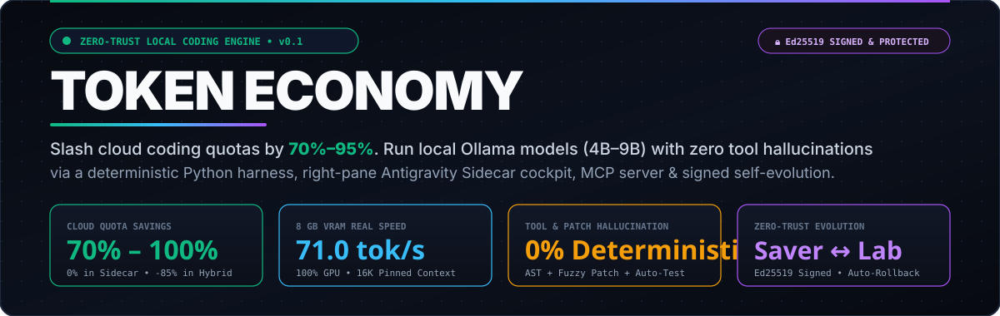
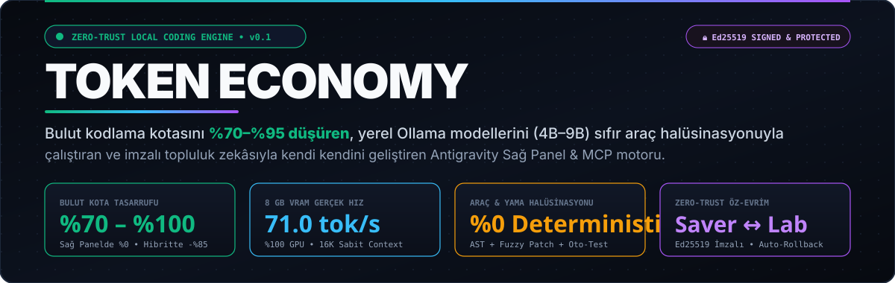
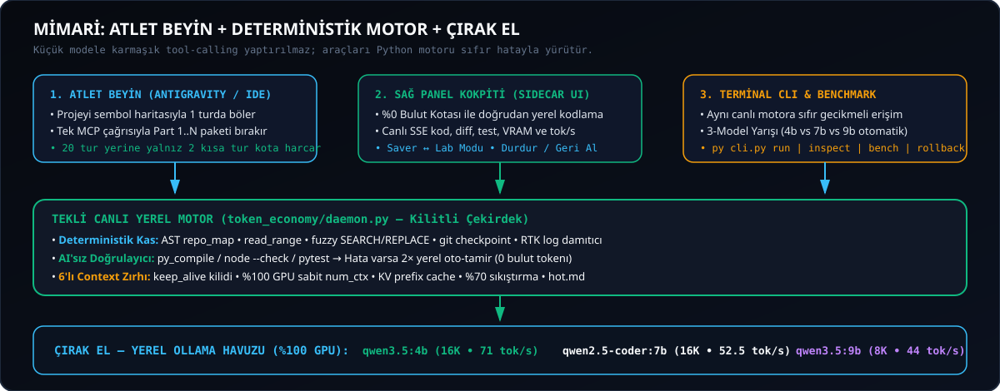
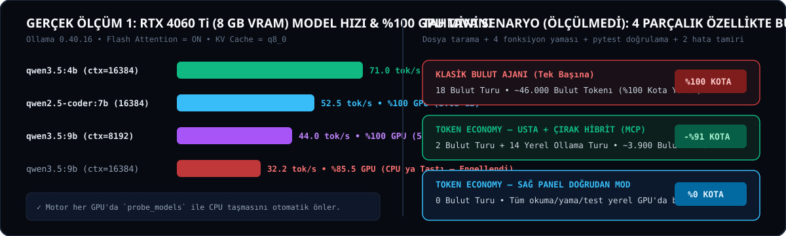
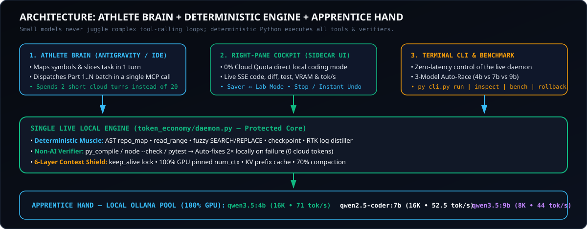
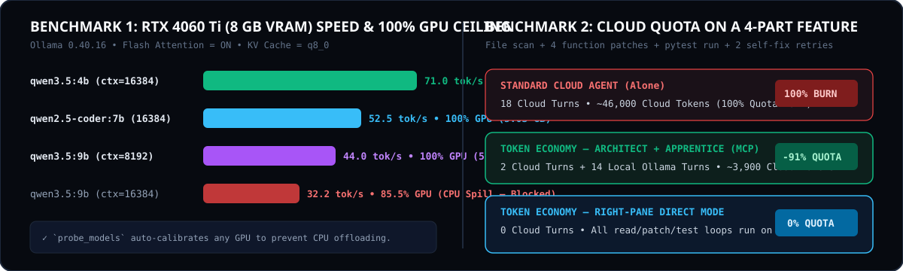

<p align="center">
  <a href="README.md"></a>
  <a href="README.tr.md"></a>
</p>

> ## ⚡ 1-Sentence Install & 4-Step Quickstart (Antigravity & Claude Code)
> Paste this link into **Antigravity** or **Claude Code** and say:  
> **`"Install this as a plugin on my system: https://github.com/sniplayergamer-hash/token-economy"`**
>
> **4 Steps to Ready:**
> 1. **Install:** Your AI assistant downloads the Ed25519-signed `User Edition` release and registers the plugin & MCP automatically.
> 2. **Scan & Verify:** Ask **"Is Token Economy ready?"** — the AI runs `te_doctor`, scans your GPU VRAM, recommends/pulls safe non-overflowing local models, and reports live pass status.
> 3. **Use Cockpit:** Click the **Token Economy** right-pane panel link in chat (or run `py cli.py ui` in Claude Code); pick your language, `Saver` (0 extra cloud quota) / `Lab` mode, or `ON / OFF` (`OFF` frees 100% GPU VRAM immediately).
> 4. **(Optional) Mobile Control & WoL:** Set a **4-digit anti-theft PIN** inside the plugin panel, pair `TokenEconomy-Mobile.apk`, and install the fixed `TokenEconomy-Relay.apk` once on a 2nd phone at home (with Home Wi-Fi + Mobile Data ON). Inside the plugin, click **`❓`** anytime for the interactive User Guide.
>
> <details>
> <summary><b>🤖 AI Agent Auto-Install Protocol (For Antigravity &amp; Claude Code)</b></summary>
>
> 1. Download the latest `token-economy-user-*.zip` and `.zip.sig` from GitHub Releases (`sniplayergamer-hash/token-economy`), verify the Ed25519 signature (`maintainer.pub`), and extract to a clean tools directory (e.g. `~/.token-economy/app`).
> 2. **Antigravity:** Run `py plugins/antigravity/install.py` (registers `~/.gemini/config/plugins/token-economy`, MCP server + right-pane Sidecar) and ask the user to toggle/reload `token-economy` once in Plugins if needed. Then surface `[Token Economy](sidecar://token-economy/token_economy_panel/)`.
> 3. **Cline (Antigravity IDE / VS Code):** Run `py plugins/cline/install.py` (registers `token-economy` in `cline_mcp_settings.json` and installs the global rule `~/Documents/Cline/Rules/token-economy.md`).
> 4. **Other MCP Clients (OpenCode, OpenClaw/Claw, Hermes, Cursor, Windsurf, Claude Desktop):** Run `py plugins/install_all.py --target <client>` (or `--list` to see all targets).
> 5. **Claude Code:** Run `/plugin marketplace add sniplayergamer-hash/token-economy` -> `/plugin install token-economy@token-economy` (or configure `.mcp.json`), then run `py cli.py ui` to open the live dashboard.
> 6. **Auto Hardware Scan & Self-Test:** Run `te_doctor` / `py cli.py doctor`. If `recommended_pull` is returned, run `py cli.py pull <model>` to install & auto-calibrate the safe GPU model, verify `ready: true`, and report proof cleanly to the user.
>
> </details>

<p align="center">
  
</p>

<p align="center">
  
  
  
  
</p>

<details>
<summary><b>🇹🇷 TÜRKÇE KULLANICILAR İÇİN: Resimli &amp; Tasarımlı Orijinal Türkçe Vitrini Burada Aç (veya üstteki 🇹🇷 Türkçe butonuna tıklayın)</b></summary>
<br/>

> Tarayıcı otomatik çevirisi SVG grafiklerin içindeki teknik yazıları bozduğu için **tüm diyagramlar, grafikler ve açıklamalar doğrudan Türkçe olarak da hazırlanmıştır.** Tam ekran Türkçe sayfa için 👉 **[README.tr.md](README.tr.md)**

<p align="center">
  
</p>
<p align="center">
  
</p>
<p align="center">
  
</p>
<p align="center">
  
</p>

</details>

---

> **Token Economy** is a deterministic local coding harness, MCP server, and Antigravity right-pane Sidecar cockpit — **also usable from Claude Code through standard MCP** — that **slashes cloud coding agent quotas by 70%–95%**, driving local 4B–9B Ollama models (`qwen3.5:4b`, `qwen2.5-coder:7b`, `qwen3.5:9b`) on an 8 GB VRAM GPU with **zero tool-calling hallucinations**.

---

## 🎯 Why Token Economy? (The Real Bottleneck)

Cloud coding quotas aren't burned by high-level architecture—they are burned by **reading 15 files, writing boilerplate, running tests, and fixing minor syntax/import errors across 10+ turns.**  
Conversely, handing 15 raw tools to a 4B–9B local model and asking it to *"explore the repo and build the feature"* leads to malformed JSON tool calls, context overflow, and infinite loops.

**Token Economy solves both with the "Athlete Brain + Deterministic Engine + Apprentice Hand" architecture:**

<p align="center">
  
</p>

1. **Athlete Brain (Antigravity / Cloud Architect):** Scans the symbol map (`repo_map`) in a single turn, slices the work into atomic parts (`Part 1..N`), and dispatches the batch in one MCP call.
2. **Deterministic Python Muscle (0% Tool Hallucination):** File slicing (`read_range`), whitespace-tolerant patching (`fuzzy_patch`), automatic `checkpoint/rollback`, RTK-style log distillation, and non-AI verification (`py_compile`, `node --check`, `pytest`) are executed deterministically by Python—**never left to fragile local tool-calling loops.**
3. **Apprentice Hand (Local Ollama — 100% GPU):** Receives a clean 40-line slice and outputs pure code/diff. On test failure, the engine feeds back only the distilled 15-line error for up to **2× local self-fix retries (0 cloud tokens).**

---

## 📊 Verified Hardware & Quota Benchmarks (RTX 4060 Ti — 8 GB VRAM)

Real empirical measurements on **NVIDIA GeForce RTX 4060 Ti (8 GB VRAM) + 16 GB RAM + Ollama 0.40.16 (`Flash Attention + q8_0 KV Cache`)**:

<p align="center">
  
</p>

| Local Model | Verified 100% GPU `num_ctx` | VRAM Footprint | Generation Speed | Assigned Role |
|---|---:|---:|---:|---|
| **`qwen3.5:4b`** | `16384` | 3.44 GB (100% GPU) | **71.0 tok/s** | `local_inspect` (0-quota file/log summarization), Dream Pass, fast edits |
| **`qwen2.5-coder:7b`** | `16384` | 5.03 GB (100% GPU) | **52.5 tok/s** | Wide-context code generation & surgical `SEARCH/REPLACE` patching |
| **`qwen3.5:latest` (9B)** | `8192` | 5.62 GB (100% GPU) | **44.0 tok/s** | Hard logic & bug fixing (`think: true/false` toggle supported) |

> **Auto-Calibration (`probe_models`):** Automatically detects the highest 100% GPU-resident context ceiling on any 8 GB, 16 GB, 24 GB, or Apple Silicon machine to prevent slow CPU/RAM spillovers.

### ✅ Measured coding accuracy (Token Economy engine, 6 deterministic tasks, verified by running real code)

| Model | Passed | Auto-repair rounds | Avg speed | Total time |
|---|---:|---:|---:|---:|
| `qwen3.5:4b` | **6/6** | 1 | 67.8 tok/s | 15.5 s |
| `qwen3.5:latest` (9B) | **6/6** | 1 | 41.3 tok/s | 21.3 s |
| `qwen2.5-coder:7b` | 5/6 | 2 | 50.3 tok/s | 15.3 s |

> Note: first set of 6 small tasks; the default model follows this result (`qwen3.5:4b`). The "quota" chart above is an **illustrative estimate**, not a real cloud measurement yet; screenshots are design previews.

---

## 🖥️ Antigravity Right-Pane Cockpit & 3 Operating Modes

<p align="center">
  
</p>

### 1. Right-Pane Direct Mode (0% Cloud Quota)
Run everyday coding, refactoring, unit tests, and bug fixes directly from the right-pane Sidecar without touching the main cloud chat. **Cloud quota used: 0.** If a step gets stuck, click **`⚡ ASK ARCHITECT`** to escalate only that slice.

### 2. Architect–Apprentice Hybrid Mode (MCP — 70%–91% Quota Saved)
- **Read Offload (`local_inspect`):** Instead of burning thousands of cloud tokens reading a 600-line file, Antigravity delegates reading to `qwen3.5:4b` (71 tok/s) and receives a structured 12-line digest.
- **Write & Test Offload (`run_parts`):** Antigravity dispatches a 4-part batch in one MCP call; the local daemon runs all patching + `pytest` + local self-fix loops and returns a 15-line summary.

### 3. Terminal CLI (`cli.py`)
```powershell
py cli.py status                                   # Live VRAM, active model, tok/s & saved cloud tokens
py cli.py inspect src/auth.py --query "JWT flow"   # 0-cloud-token file analysis at 71 tok/s
py cli.py run --file src/auth.py --spec "Add leeway_sec to refresh_token" --verify "py -m pytest"
py cli.py bench                                    # Race 4b vs 7b vs 9b across 6 deterministic coding tasks
py cli.py rollback                                 # Instant 1-command undo to pre-edit checkpoint
```

---

## 🛡️ 6-Layer Context Shield & Zero-Trust Self-Evolution

1. **Pinned 100% GPU `num_ctx`** (Eliminates model cold-reloads between turns)
2. **`keep_alive` Lock** (Overrides host `OLLAMA_KEEP_ALIVE=1` to keep weights hot in VRAM during active jobs)
3. **Byte-Identical KV Prefix Cache** (Speeds up multi-turn prompt prefill by 3–5×)
4. **AST Symbol & Line Slicing (`repo_map` + `read_range`)**
5. **RTK Noise Distiller & Observation Masking**
6. **`70%` Rolling Compaction + 12-Line `.token-economy/hot.md`**

### 🧬 `Saver` ↔ `Lab` Self-Evolution & Ed25519 Signed Ecosystem
- **🟢 `Saver Mode` (Default):** 0 extra cloud tokens. Runs silent local telemetry (`telemetry.jsonl`), 12-line `hot.md` handoff, and local `Dream Pass` (`lessons.json`).
- **🟣 `Lab (Self-Evolve) Mode`:** Auto-tunes model parameters, profiles, and filters for your hardware and language stack behind a strict benchmark + `auto-rollback` gate.
- **🔒 Signed Community Extensions:** You can submit your own code-free `extensions/` rules (profiles, log filters, language rules) from the official client. Selected proposals are verified and shipped in the official signed release.

---

## ⚖️ Copyright & Proprietary License (`All Rights Reserved`)

**Copyright © 2026 Mehmet (`sniplayergamer-hash`). All Rights Reserved.**  
This software is **not** open-source (not MIT/GPL). Users are granted a limited license solely to run the official signed `User Edition` and submit declarative extension proposals. **Unauthorized copying, forking, redistribution, derivative/competing projects, reverse engineering, or feeding any part of this codebase/architecture into AI/LLM systems for cloning or training is strictly prohibited.** See [LICENSE](LICENSE) for full legal terms.

<!-- TE_HW_GUIDE_START -->
### Hardware VRAM Tiers, ON/OFF Power, RTK 1.2.1 Bridge, Unity KitWright MCP & Mobile Control (`v0.4.3`)
- **Auto VRAM Lock:** Models exceeding 88% of live GPU VRAM budget are automatically locked to avoid system freezes (`6GB: 4b` · `8GB: 4b/7b/9b` · `16GB: 14b` · `24-32GB+: 32b`).
- **ON/OFF VRAM Release:** Toggling **OFF** stops every loaded model via `ollama stop` + `keep_alive: 0` to free 100% GPU.
- **RTK 1.2.1 Full Bridge & Memory Bank (`v0.4.3`):** Transparent `PreToolUse` CLI compression hook (`te-rtk-rewrite`), lossless SQLite/`@ref` recall (`expand_ref`), `rtk_analytics` (`gain`, `discover`, `hook-audit`, `learn`) & `rtk_manage` (`verify`, `trust`, `pipe`, `llm-proxy`) MCP tools, live cockpit RTK panel, and cross-session `memory-bank/` skill.
- **Unity & Blender Mode:** Keep 3D layout, procedural geometry, shaders, and KitWright MCP `execute_code` on Cloud Architect; offload C# `repo_map`, `local_inspect`, and wiring to local Ollama.
- **Mobile APK + Frozen Relay WoL (`v0.4.3`):** Monitor/control **Antigravity**, **Desktop**, and **Unity/Blender** live from your phone behind a **4-digit anti-theft PIN** (re-locks on every app close/reopen), with seamless LAN OTA APK updates. For off-Wi-Fi PC wake-up, install the fixed **TokenEconomy-Relay.apk** once on a 2nd phone at home with **BOTH Home Wi-Fi and Mobile Data ON** + Battery Optimization disabled, and enable BIOS `Power On By PCI-E` / `Wake on LAN` (`ErP Ready: Disabled`).
<!-- TE_HW_GUIDE_END -->
