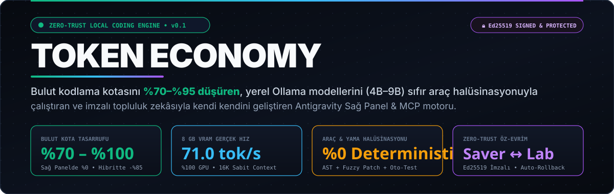
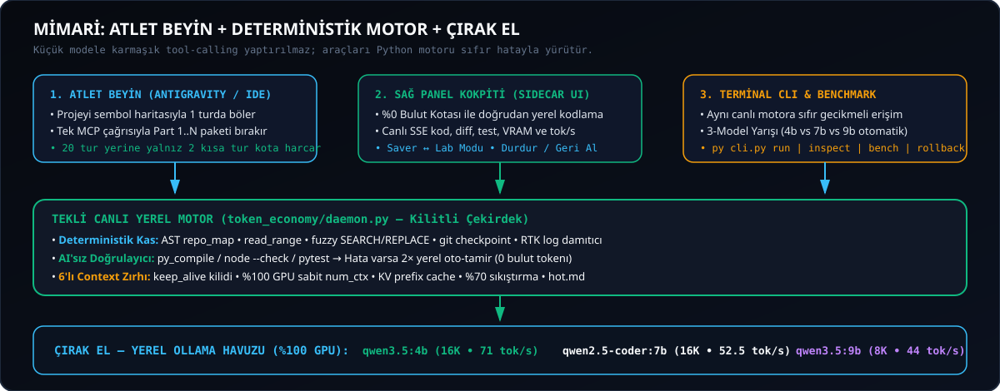
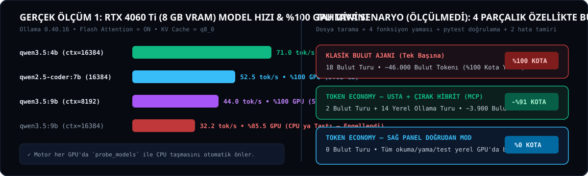
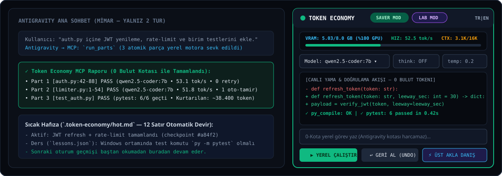

<p align="center">
  <a href="README.md"></a>
  <a href="README.tr.md"></a>
</p>

<p align="center">
  
</p>

<p align="center">
  
  
  
  
</p>

> **Token Economy**, bulut kodlama ajanlarının pahalı token kotasını **%70 ila %95 oranında düşüren** deterministik kodlama motoru, MCP sunucusu ve **Antigravity** sağ panel kokpitidir; standart MCP sayesinde **Claude Code ile de çalışır**. 8 GB VRAM'li standart bir ekran kartında bile yerel Ollama modellerini (`qwen3.5:4b`, `qwen2.5-coder:7b`, `qwen3.5:9b`) **sıfır araç halüsinasyonuyla** çalıştırır.

---

## 🎯 Neden Token Economy? (Çözdüğü Gerçek Sorun)

Bulut kodlama ajanlarında kotayı bitiren şey "mimari düşünme" değildir; **15 dosya okumak, boilerplate yazmak, test koşmak ve küçük syntax/import hatalarını 10 tur boyunca düzeltmektir.**  
Öte yandan küçük yerel modellere (4B–9B) doğrudan 15 araç verip *"tüm projeyi gez ve kodla"* dediğinizde JSON şeması bozulur, context taşar ve döngüye girer.

**Token Economy bu ikilemi "Atlet Beyin + Deterministik Motor + Çırak El" mimarisiyle çözer:**

<p align="center">
  
</p>

1. **Atlet Beyin (Antigravity / Bulut Mimar):** Projeyi sembol haritasıyla (`repo_map`) tek turda tarar, işi küçük atomik parçalara (`Part 1..N`) böler ve tek bir MCP çağrısıyla yerel motora devreder.
2. **Deterministik Python Kas Sistemi (0 Araç Halüsinasyonu):** Dosya okuma (`read_range`), toleranslı yama (`fuzzy_patch`), otomatik `checkpoint/rollback`, RTK-tarzı log gürültü damıtma ve AI'sız doğrulama (`py_compile`, `node --check`, `pytest`) işlerini **Ollama'ya bırakmaz, doğrudan Python yürütür.**
3. **Çırak El (Yerel Ollama — %100 GPU):** Karmaşık tool-calling kararı vermez; önüne konan 40 satırlık kesite göre sadece temiz kod/yama üretir. Test patlarsa bulut ajanını uyandırmadan **yerelde 2 kez kendi kendini tamir eder (0 bulut kotası).**

---

## 📊 Gerçek Donanım & Kota Ölçümleri (RTX 4060 Ti — 8 GB VRAM)

<p align="center">
  
</p>

| Yerel Model | Güvenli %100 GPU `num_ctx` | VRAM Kullanımı | Üretim Hızı | Görevdeki Rolü |
|---|---:|---:|---:|---|
| **`qwen3.5:4b`** | `16384` | 3.44 GB (%100 GPU) | **71.0 tok/s** | `local_inspect` (0-kota dosya/log özetleme), Dream Pass, hızlı yama |
| **`qwen2.5-coder:7b`** | `16384` | 5.03 GB (%100 GPU) | **52.5 tok/s** | Geniş bağlamlı saf kod üretimi ve cerrahi `SEARCH/REPLACE` yaması |
| **`qwen3.5:latest` (9B)** | `8192` | 5.62 GB (%100 GPU) | **44.0 tok/s** | Karmaşık mantık ve zor hata ayıklama (`think: true/false` destekli) |

---

## 🖥️ Antigravity Sağ Panel Kokpiti & 3 Çalışma Modu

<p align="center">
  
</p>

1. **Sağ Panel Doğrudan Mod (%0 Bulut Kotası):** Rutin kodlama, refactor, birim test ve hata düzeltmelerini Antigravity ana sohbetine hiç yazmadan doğrudan sağ panelden yerel motora yaptırın. Takıldığı noktada tek tuşla (**`⚡ Üst Akla Danış`**) yalnız o parçayı Antigravity'ye sorun.
2. **Usta–Çırak Hibrit Modu (MCP — %70–%91 Kota Tasarrufu):** `local_inspect` ile büyük dosyaları 0 bulut tokenıyla `qwen3.5:4b` özetler; `run_parts` ile çoklu-parça kodlama ve test döngüsü yerelde tamamlanır.
3. **Terminal CLI (`cli.py`):**
   ```powershell
   py cli.py status                                  # Canlı VRAM, aktif model, tok/s ve kurtarılan kota
   py cli.py inspect src/auth.py --query "JWT akışı" # 0 bulut tokenı ile hızlı dosya analizi (71 tok/s)
   py cli.py run --file src/auth.py --spec "refresh_token içine leeway parametresi ekle" --verify "py -m pytest"
   py cli.py bench                                   # 4b vs 7b vs 9b modellerini 6 gerçek görevde yarıştır
   py cli.py rollback                                # Son yamayı tek komutla geri al
   ```

---

## 🛡️ Context Sınırına Karşı 6'lı Zırh & Zero-Trust İmzalı Öz-Evrim

- **6'lı Context Zırhı:** Sabit %100 GPU `num_ctx`, `keep_alive` kilidi, byte-sabit KV Prefix Cache, AST sembol kesiti (`repo_map`), RTK log damıtıcı + observation masking, `%70` rolling compaction ve 12 satırlık `.token-economy/hot.md`.
- **`Saver` ↔ `Lab` Modu:** `Saver` modunda %0 ek bulut maliyeti; `Lab` modunda kendi GPU ve proje dilinize göre benchmark kapılı (`auto-rollback` korumalı) öz-evrim.
- **İmzalı Topluluk Önerileri:** Kendi geliştirdiğiniz kodsuz `extensions/` kurallarını (profil, log filtresi, dil kuralı) resmî istemciden gönderebilirsiniz. Seçilen öneriler doğrulanıp resmî imzalı sürüme eklenir.

---

## ⚖️ Telif Hakkı ve Lisans (`All Rights Reserved`)

**Copyright © 2026 Mehmet (`sniplayergamer-hash`). Tüm Hakları Saklıdır.**  
Bu yazılım açık kaynaklı (MIT/GPL) **değildir**. Telif sahibinin yazılı izni olmadan **kopyalanması, çatallanması (fork), türev/benzer proje yapılması, tersine mühendislik uygulanması veya kodlarının/mimarisinin yapay zekâ modellerine okutularak klonlatılması** kesinlikle yasaktır. Ayrıntılar için [LICENSE](LICENSE) dosyasına bakınız.
